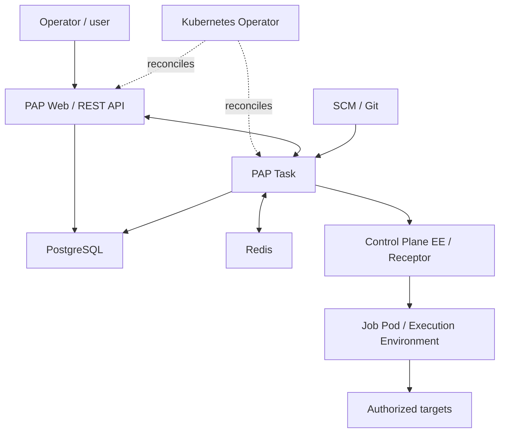

# 🔥 Phoenix Automation Platform (PAP)
### Community Edition — Contributions hub

**[Español](README.md) · [English](README.en.md)**

**Ansible · Kubernetes / K3s · AlmaLinux · Execution Environments**

> **Community project in preparation.** This repository contains community guidelines, documentation and proposals. Installable distribution sources will be added only after the relevant licensing, attribution, dependency and publication reviews.

## ✨ About

**Phoenix Automation Platform (PAP)** is an independent initiative based on **AWX** and related open-source projects. It builds on familiar Ansible capabilities — web UI, REST API, inventories, projects, templates and Jobs — while evolving container packaging, software traceability and operational experience on Kubernetes/K3s.

PAP began as a controlled modernization effort for inherited AWX 24.6.1 image and dependency baselines, with AlmaLinux-based images and end-to-end lab testing.

## 🏗 Architecture

## ✅ Current status

The RC2 candidate passed functional laboratory checks, including database migration, UI/API availability and two Jobs using customized Execution Environments. This community repository is preparing its contributor workflow; it is not yet an installable software distribution.

## 🤝 How to contribute

Review [CONTRIBUTING.md](CONTRIBUTING.md), check existing Issues, fork the project and open Pull Requests to the planned `dev` integration branch once enabled. The planned `prd` branch will hold reviewed stable releases. **No community branches have been created yet.**

## 📚 Community documentation

| File | Purpose |
| --- | --- |
| [README.md](README.md) | Spanish introduction |
| [CONTRIBUTING.md](CONTRIBUTING.md) | Contribution and review process |
| [CODE_OF_CONDUCT.md](CODE_OF_CONDUCT.md) | Community expectations |
| [SECURITY.md](SECURITY.md) | Responsible security reporting |
| [SUPPORT.md](SUPPORT.md) | Community support scope |
| [NOTICE.md](NOTICE.md) | Upstream and third-party attribution |
| [LICENSE](LICENSE) | License text |
| [docs/COMMUNITY-SETUP.md](docs/COMMUNITY-SETUP.md) | Planned `dev` / `prd` protection setup |

## ⚖️ Origin and licensing

PAP acknowledges [AWX](https://github.com/ansible/awx) as an upstream reference under the **Apache License 2.0**. PAP is an independent initiative and not an official or endorsed upstream distribution. See [NOTICE.md](NOTICE.md) and [LICENSE](LICENSE).

Build reproducible · Execute with control · Improve with community

