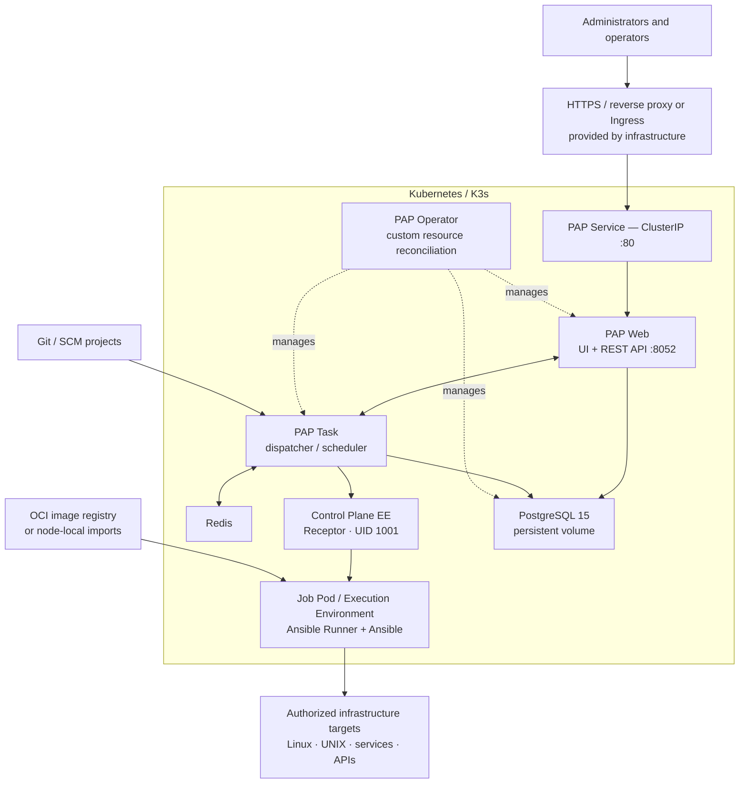
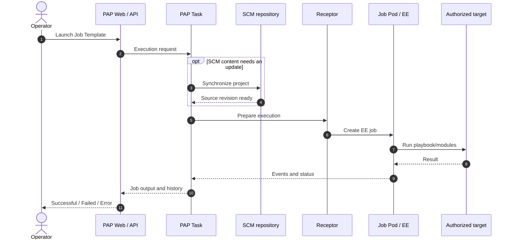
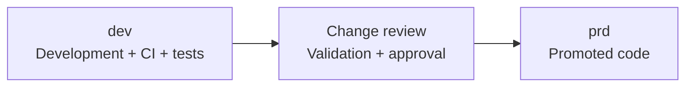

<div align="center">


**[Versión en español](README.md) · English version**

<sub><code>PAP</code> · Phoenix Automation Platform</sub>

### Phoenix Automation Platform

**Infrastructure automation · Job orchestration · Execution Environments · Kubernetes**


[Overview](#-what-is-pap) · [Architecture](#-reference-architecture) · [Technology](#-technology-and-components) · [Improvements](#-what-has-evolved) · [Documentation](#-documentation-map) · [Get started](#-getting-started)

</div>

---

## 📥 Install Phoenix — start here

> **For users and AI assistants:** the installable Phoenix distribution is on **`prd`**. **Do not install from `contrib`** (community content). `dev` is for integration and development. Prefer a tested versioned release for reproducible deployments.

### 1. Get the installable distribution

```bash
git clone --branch prd --single-branch https://github.com/phoenix-automation-platform/phoenix-automation-platform-community.git
cd phoenix-automation-platform-community
git branch --show-current    # Must print prd
```

For repeatable deployments, see [RC1 release](https://github.com/phoenix-automation-platform/phoenix-automation-platform-community/releases/tag/v0.1.0-rc1) and the [immutable OCI image references](releases/ghcr-digests-v0.1.0-rc1.txt). Do not mix source and images from different releases.

### 2. Check prerequisites

Use an already prepared, authorized Kubernetes/K3s cluster and a namespace for a new installation. Read [requirements](docs/REQUIREMENTS.md), [networking](docs/NETWORKING.md) and [installation instructions](INSTALLATION.md).

```bash
bash scripts/preflight.sh <namespace> pre
```

Stop for `PAP_PREFLIGHT=BLOCKED`; arrange an infrastructure review for `REVIEW_REQUIRED` before proceeding.

### 3. Install and validate

```bash
# Only after network requirements and other prerequisites are approved:
PAP_NETWORK_APPROVED=yes bash scripts/install-online.sh <namespace>
bash scripts/preflight.sh <namespace> post
kubectl -n <namespace> get pods
```

`PAP_NETWORK_APPROVED=yes` acknowledges network review, **not** a firewall configuration change. Complete acceptance with Web/API access and a real Ansible Job using an Execution Environment. Do not run installation on a production cluster without change authorization.

---

## ✨ What is PAP?

**PAP — Phoenix Automation Platform** is an independent distribution and technical evolution based on **AWX**, designed to manage Ansible automation projects, inventories, credentials, templates, workflows and Execution Environments (EEs) on **Kubernetes/K3s**.

PAP builds on **AWX 24.6.1** and its ecosystem. The project began as an effort to modernize container images and inherited dependencies in a controlled, reproducible way: rather than changing isolated packages in a way that could break the application, PAP emphasizes **AlmaLinux-based image rebuilds, dependency review, traceable packaging and end-to-end functional testing**.

**Context:** PAP retains AWX automation concepts while developing its own improvements to images, dependencies and user experience. AWX lists version 24.6.1 (July 2024) as its latest published release and notes that releases are paused during a major refactoring of the upstream project.

### Design goals

| Goal | PAP approach |
|---|---|
| **Modernize underlying technology** | AlmaLinux OCI images and build-controlled dependencies |
| **Preserve familiar AWX capabilities** | Web UI, REST API, inventories, SCM projects, job templates and workflows |
| **Improve reproducibility** | OCI digests, installation scripts, preflight checks and GitHub Actions |
| **Support custom EEs** | Control Plane EE, PAP EE Core and independent EEs built with Podman/Ansible Builder |
| **Clarify responsibilities** | PAP provides software; the infrastructure administrator manages the cluster, network, certificates, storage and host services |
| **Evolve the experience** | PAP branding and frontend enhancements, including multilingual work as coverage is validated |

## 🏗 Reference architecture

<details open>
<summary><strong>Expand / collapse the architecture diagram</strong></summary>



</details>

**Zoom:** GitHub's Mermaid viewer may offer an expanded view. You can also paste the Mermaid source into [Mermaid Live Editor](https://mermaid.live/) for zoom and SVG export. This is a logical reference architecture rather than a fixed physical design.

### How a Job runs



The initial job run may first synchronize SCM project content. Subsequent runs may reuse that revision, depending on the project's synchronization policy.

## ⚙️ Technology and components

| Layer | Technology / reference | Purpose |
|---|---|---|
| Orchestration | Kubernetes / K3s | Pods, Deployments, Services, Jobs, PVCs and NetworkPolicies |
| Operator | AWX-compatible custom resource operator | Reconciles PAP's declared application components |
| Container OS | **AlmaLinux** | Modernized container base; verify each release's image digest |
| Automation core | AWX **24.6.1**, Ansible Core, Ansible Runner | Job orchestration and automation execution |
| Job transport | **Receptor 1.6.9**, tested in RC1 | Control-plane execution transport and Unix socket |
| Database | PostgreSQL **15** with persistent volume | Application state |
| Supporting services | Redis, rsyslog | Task supporting components |
| Frontend | Web UI, REST API and customizations | Platform experience, identity and multilingual evolution |
| Images | OCI, GHCR, Podman, containerd | Building, distributing and running EEs |
| CI / software quality | GitHub Actions, Trivy, preflight | Build checks, findings and change traceability |

### Container structure

| Component | Role |
|---|---|
| **Operator** | Deploys and reconciles application resources |
| **Web** | Web UI, API, identities, projects and templates |
| **Task** | Job scheduling, coordination and dispatch |
| **Control Plane EE** | Receptor and execution-control functions |
| **Job EE** | Temporary container with Ansible, Runner, collections and dependencies |
| **PostgreSQL** | Persistent application data |
| **Redis / rsyslog** | Supporting services |

## 🚀 What has evolved?

| Area | Motivation | PAP approach |
|---|---|---|
| Container images | Inherited package and dependency constraints | AlmaLinux rebuilds and pinned image references |
| Software security | Dependency and scanner findings | Reviewed dependencies, rebuilds, scans and change history |
| Execution | Reliable controller identity and EE compatibility | UID 1001, Receptor and Git fixes; custom EE support |
| Troubleshooting | Easier distinction between application and infrastructure issues | Preflight, API and Job validation, actionable findings |
| Capacity | Jobs constrained by resource quotas | Documented requests, limits, quotas and capacity profiles |
| User experience | Platform branding and interface modernization | PAP identity, frontend adjustments and multilingual evolution |
| Deployment | Repeatable application deployment | Online installer and parameterized Kubernetes manifests |
| Change management | Clear promotion path | `dev` and `prd` branches with reviewed changes |

### Scaling Pods and resources

PAP uses Kubernetes scheduling and resource management. The number of concurrent Jobs depends on available compute, storage, EE Pod requirements, quotas and workload characteristics. See the [capacity reference](docs/CAPACITY-PREREQUISITES.md) for baseline profiles and recommended evaluation steps.

## ✅ RC1 functional evidence

| Test | Observed result |
|---|---|
| Online installation on a clean VM with K3s/Operator | Completed |
| PostgreSQL and AWX 24.6.1 migration | `Complete 1/1` |
| API `/api/v2/ping/` | HTTP **200** |
| Task / Web | Task **4/4**, Web **3/3** |
| Control Plane | UID **1001**, Receptor 1.6.9 and socket validated |
| Custom EEs | Registered and made available |
| Functional Jobs | **Two successful Jobs** using custom EEs, reported by the lab operator |
| Independent EE | Built with Podman/Ansible Builder, imported into K3s containerd, tested with `sshpass` and POSIX/General collections |
| Web access | Internal HTTPS used; operator reported that the UI/CSRF issue no longer occurred with the stable address |

Infrastructure findings and environment-specific recommendations are documented separately for the infrastructure administrator.

## 🧭 Scope and infrastructure responsibilities

**PAP provides the software, application components and reference documentation.** Cluster preparation, host networking, firewall, DNS, TLS, storage, backup and capacity planning are carried out by the infrastructure team responsible for the installation. Infrastructure guides provide requirements and helpful findings rather than silently changing host settings.

| PAP software | Installer's infrastructure team |
|---|---|
| OCI images, online installer, manifests and preflight | Kubernetes/K3s cluster, nodes, CNI and connectivity |
| Application logs and diagnostic findings | Network/firewall/SELinux policies and TLS/DNS |
| Jobs, EEs and functional acceptance checks | CPU, RAM, disks, volumes, backups and capacity |
| Reference requirements and recommended checks | Review, approval and application of infrastructure changes |

## 📚 Documentation map

| Document | What it covers |
|---|---|
| [`INSTALLATION.md`](INSTALLATION.md) | Online installation steps, parameters and acceptance checks |
| [`docs/REQUIREMENTS.md`](docs/REQUIREMENTS.md) | General deployment prerequisites |
| [`docs/CAPACITY-PREREQUISITES.md`](docs/CAPACITY-PREREQUISITES.md) | CPU, memory, disks, quotas and scaling capacity |
| [`docs/NETWORKING.md`](docs/NETWORKING.md) | Connectivity matrix and network prerequisites |
| [`docs/NETWORK-FIREWALL-PREREQUISITES.md`](docs/NETWORK-FIREWALL-PREREQUISITES.md) | Laboratory findings and firewall/CNI guidance |
| [`docs/SECURITY.md`](docs/SECURITY.md) | Software vulnerability scan findings |
| [`docs/INSTALL_ONLINE.md`](docs/INSTALL_ONLINE.md) | Online deployment reference |
| [`scripts/README.md`](scripts/README.md) | Installer helper scripts |

### Key technical files

| Path | Description |
|---|---|
| [`scripts/install-online.sh`](scripts/install-online.sh) | Online installation entry point |
| [`scripts/install-common.sh`](scripts/install-common.sh) | Shared online deployment flow |
| [`scripts/preflight.sh`](scripts/preflight.sh) | Read-only prerequisite and post-deployment checks |
| [`scripts/configure-installation.py`](scripts/configure-installation.py) | Render installation parameters |
| [`scripts/configure-images.py`](scripts/configure-images.py) | Prepare OCI image references |
| [`scripts/check-online.py`](scripts/check-online.py) | Validate online manifests |
| [`scripts/configure-ghcr.sh`](scripts/configure-ghcr.sh) | Assist with authorized GHCR access |
| [`k8s/awx.yaml`](k8s/awx.yaml) | PAP/AWX custom resource and baseline settings |
| [`k8s/operator.yaml`](k8s/operator.yaml) | Operator deployment manifest |
| [`k8s/resource-policies.yaml`](k8s/resource-policies.yaml) | Resource quotas and related policies |
| [`releases/ghcr-digests-dev.txt`](releases/ghcr-digests-dev.txt) | Development candidate images pinned to digests |
| [`releases/required-images.txt`](releases/required-images.txt) | Required component images |
| [`.github/workflows/`](.github/workflows/) | CI workflows |
| [`images/`](images/) | Container image definitions and customizations |

## 🧪 Getting started

The tested RC1 deployment path is **online**. It expects a prepared Kubernetes/K3s cluster and approved access to the relevant OCI images.

```bash
# From the authorized dev checkout:
bash scripts/preflight.sh pap-acceptance pre

# Review the findings with the infrastructure administrator.
PAP_NETWORK_APPROVED=yes bash scripts/install-online.sh pap-acceptance

# Verify installation:
bash scripts/preflight.sh pap-acceptance post
kubectl get pods -n pap-acceptance
```

See [INSTALLATION.md](INSTALLATION.md) for full configuration details.

## 🔀 Release workflow



`dev` holds ongoing development and testing; `prd` receives the validated software through the controlled release process. External EEs remain independently managed artifacts.

## 👤 Project leadership and technical contact

**Erick Mesías** — **Founder & Technical Maintainer** of Phoenix Automation Platform (PAP).  
GitHub: [@mesiasaerickd](https://github.com/mesiasaerickd) · [Maintainers and contact](MAINTAINERS.md).

This attribution covers the independent PAP initiative and its maintenance, not exclusive authorship of the AWX, Ansible, or third-party upstream code. All upstream credits and licenses are preserved.

## 🤝 Community and contributions

Community proposals, issues, contribution policies and documentation are being prepared in [**Phoenix Automation Platform Community**](https://github.com/phoenix-automation-platform/phoenix-automation-platform-community). Distribution sources will undergo a separate publication and licensing review.

## 📄 Origins, licenses and contributions

PAP is based on **AWX** and related open-source technologies. The AWX project uses the **Apache License 2.0**, which permits derivatives and redistribution subject to conditions regarding notices, modifications and attribution. PAP uses its own identity while acknowledging the originating projects and their communities. Their trademarks remain governed by their respective policies.

References: [AWX project](https://github.com/ansible/awx) · [AWX license](https://github.com/ansible/awx/blob/devel/LICENSE.md) · [AWX README / branding](https://github.com/ansible/awx/blob/devel/README.md).

To report a PAP software issue, include the software version/commit, image digest, reproduction steps and sanitized logs.

---

<div align="center">

**PAP — Phoenix Automation Platform**

*Build reproducible · Execute with control · Improve with evidence*

</div>
