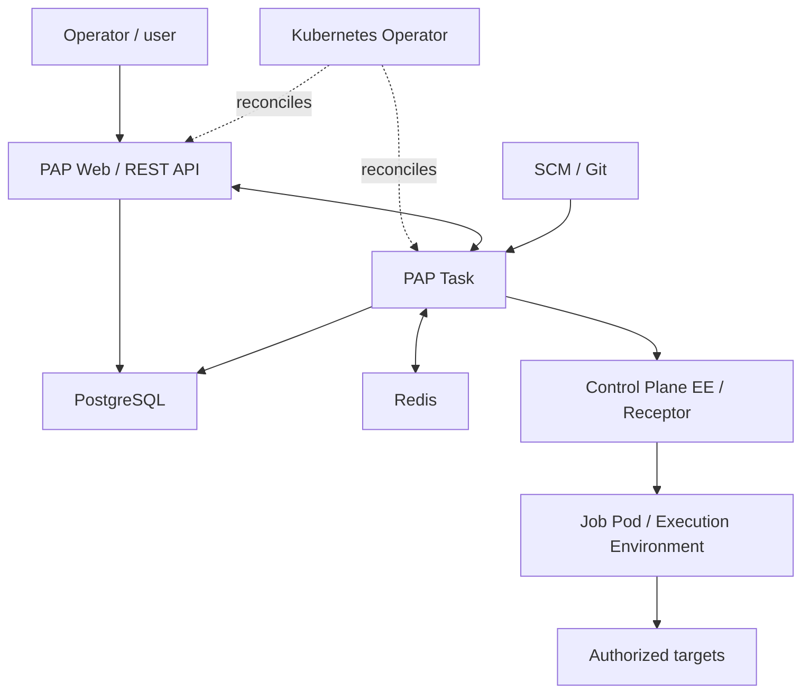

> **Installing PAP?** Use the [`prd` branch](https://github.com/phoenix-automation-platform/phoenix-automation-platform-community/tree/prd) with its [installation guide](https://github.com/phoenix-automation-platform/phoenix-automation-platform-community/blob/prd/README.en.md). Clone explicitly with `git clone --branch prd --single-branch https://github.com/phoenix-automation-platform/phoenix-automation-platform-community.git`. **`contrib` is not the installable distribution.**

> **Independent community project:** Phoenix Automation Platform is a free, open-source AWX-derived community contribution. It is not officially affiliated with, certified by, or endorsed by Red Hat, Ansible, or AWX. Latest public candidate: [v0.1.0-rc1](https://github.com/phoenix-automation-platform/phoenix-automation-platform-community/releases/tag/v0.1.0-rc1) (laboratory installation and functional tests completed and accepted).

# 🔥 Phoenix Automation Platform (PAP)
### Community Edition — Contributions hub

**[Español](README.md) · [English](README.en.md)**

**Ansible · Kubernetes / K3s · AlmaLinux · Execution Environments**

> **Community project in preparation.** This repository contains community guidelines, documentation and proposals. A public [v0.1.0-rc1](https://github.com/phoenix-automation-platform/phoenix-automation-platform-community/releases/tag/v0.1.0-rc1) candidate provides six public OCI images and an online installation path in the distribution branches. The latest full laboratory installation and functional tests were completed successfully, as confirmed by the testing owner. This is not a third-party certification or universal production approval.

## ✨ About

**Phoenix Automation Platform (PAP)** is an independent initiative based on **AWX** and related open-source projects. It builds on familiar Ansible capabilities — web UI, REST API, inventories, projects, templates and Jobs — while evolving container packaging, software traceability and operational experience on Kubernetes/K3s.

PAP began as a controlled modernization effort for inherited AWX 24.6.1 image and dependency baselines, with AlmaLinux-based images and end-to-end lab testing.

## 🏗 Architecture

## ✅ Current status

The RC1 candidate passed functional laboratory checks, including database migration, UI/API availability and two Jobs using customized Execution Environments. This community repository is preparing its contributor workflow; The latest full installation and functional validation have been accepted in the laboratory; see the final technical closure record.

## 👤 Project leadership and technical contact

**Erick David Mesias Arana** — **Founder & Technical Lead** of Phoenix Automation Platform (PAP).  
GitHub: [@mesiasaerickd](https://github.com/mesiasaerickd) · [Maintainers and contact](MAINTAINERS.md).

**Participation structure:** Core Maintainers, Development & QA, and Community Contributors are open collaboration areas, not claims of appointed team members. See [project roles](MAINTAINERS.md).

This recognizes independent PAP development and maintenance, not exclusive authorship of AWX, Ansible or other upstream components. Their credits and licenses remain in effect.

## 🤝 How to contribute

Review [CONTRIBUTING.md](CONTRIBUTING.md), check existing Issues, fork the project and open Pull Requests to the `contrib` branch; maintainers promote reviewed work to `dev` and then `prd`. The `prd` branch is reserved for reviewed stable releases, while `contrib` contains community documentation. **Community branches exist:** `contrib`, `dev`, and `prd`. The default branch is `contrib`. Check [branch policy](docs/COMMUNITY-SETUP.md) and verify effective repository rules before promotion.

## 📚 Community documentation

| File | Purpose |
| --- | --- |
| [README.md](README.md) | Spanish introduction |
| [CONTRIBUTING.md](CONTRIBUTING.md) | Contribution and review process |
| [CODE_OF_CONDUCT.md](CODE_OF_CONDUCT.md) | Community expectations |
| [SECURITY.md](SECURITY.md) | Responsible security reporting |
| [SUPPORT.md](SUPPORT.md) | Community support scope |
| [NOTICE.md](NOTICE.md) | Upstream and third-party attribution |
| [LICENSE](LICENSE) | License text |
| [docs/COMMUNITY-SETUP.md](docs/COMMUNITY-SETUP.md) | Planned `dev` / `prd` protection setup |

## Technical and release closure

- [Redis provenance, security and functional acceptance](docs/REDIS-CLOSURE.md) (Spanish)
- [Release evidence and acceptance matrix](docs/RELEASE-CLOSURE.md) (Spanish)

The final laboratory installation and functional tests have been completed and accepted. RC1 digests remain historical references for that published candidate.

[General release closure record](docs/GENERAL-CLOSURE.md) (Spanish): finalized laboratory installation, functional acceptance and project closure.

## ⚖️ Origin and licensing

PAP acknowledges [AWX](https://github.com/ansible/awx) as an upstream reference under the **Apache License 2.0**. PAP is an independent initiative and not an official or endorsed upstream distribution. See [NOTICE.md](NOTICE.md) and [LICENSE](LICENSE).

Build reproducible · Execute with control · Improve with community

