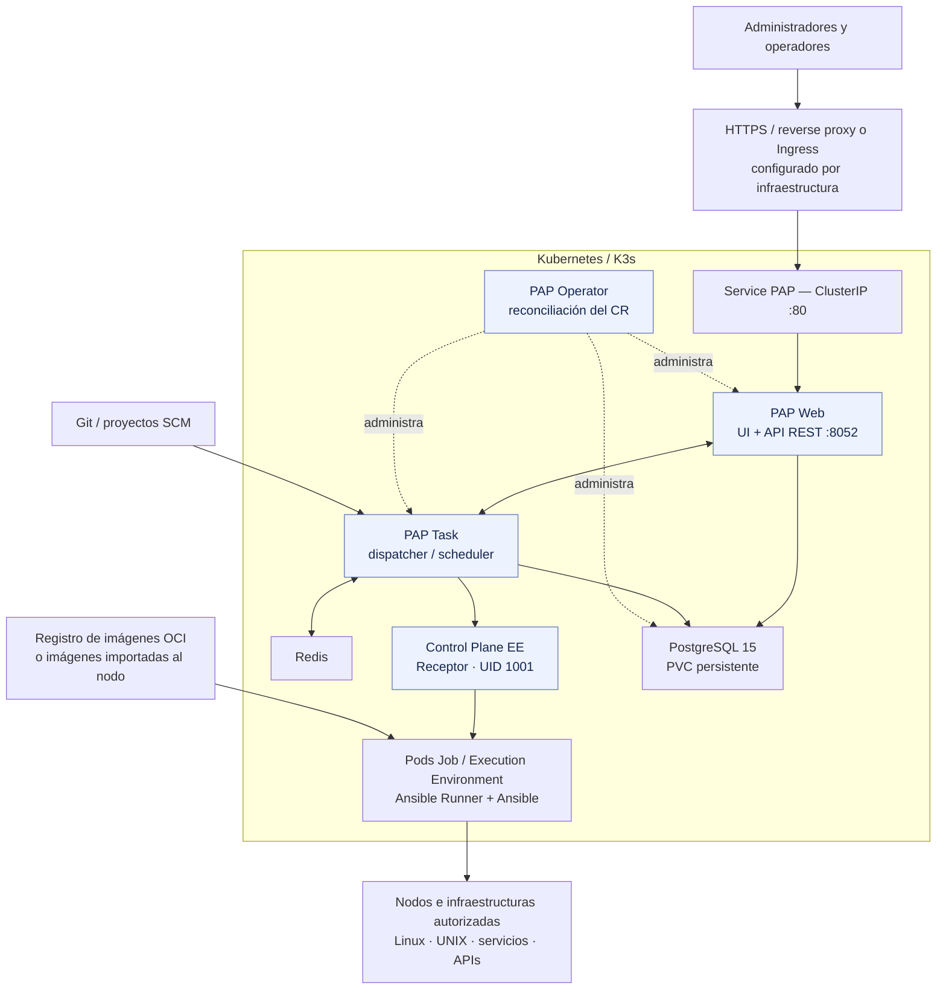
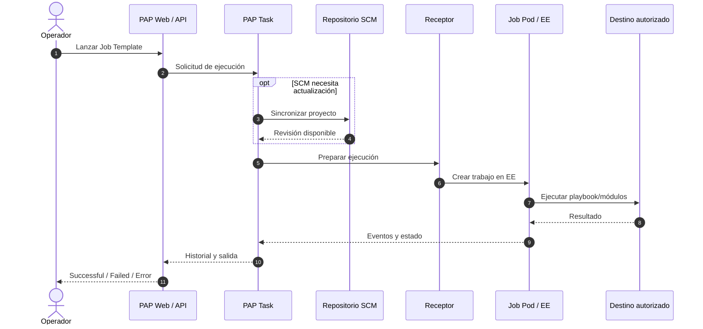
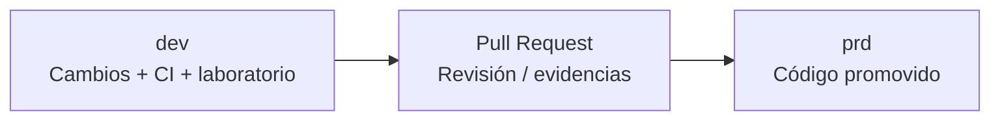

<div align="center">


**Español (predeterminado) · [English version](README.en.md)**

<sub><code>PAP</code> · Phoenix Automation Platform</sub>

### Phoenix Automation Platform

**Automatización de infraestructura · Orquestación de Jobs · Execution Environments · Kubernetes**


[Introducción](#-qué-es-pap) · [Arquitectura](#-arquitectura-de-referencia) · [Tecnologías](#-tecnologías-y-componentes) · [Mejoras](#-qué-aporta-esta-evolución) · [Documentación](#-mapa-de-documentación) · [Instalación](#-cómo-empezar)

</div>

---

## ✨ Qué es PAP

**PAP — Phoenix Automation Platform** es una distribución y evolución técnica basada en **AWX**, concebida para administrar proyectos de automatización Ansible, inventarios, credenciales, plantillas, flujos de trabajo y entornos de ejecución sobre **Kubernetes/K3s**.

El proyecto parte de **AWX 24.6.1** y de los componentes de su ecosistema. Surgió al identificar las dificultades de mantener una base de imágenes y dependencias antigua frente a actualizaciones, compatibilidad y hallazgos de vulnerabilidades. En lugar de actualizar paquetes aislados hasta romper dependencias, PAP explora la **reconstrucción de imágenes sobre AlmaLinux, revisión de dependencias, empaquetado controlado y pruebas end-to-end**.

> **Contexto:** PAP es una iniciativa independiente basada en la tecnología abierta de AWX, que conserva su base de automatización y desarrolla una evolución propia de imágenes, dependencias y experiencia de uso. AWX identifica a 24.6.1 (julio de 2024) como el último release publicado y explica que sus releases están pausados durante una refactorización importante.

### Objetivos de diseño

| Objetivo | Enfoque de PAP |
|---|---|
| **Actualizar la base tecnológica** | Imágenes OCI basadas en AlmaLinux y dependencias controladas por build |
| **Conservar las funciones conocidas de AWX** | UI, API REST, inventarios, proyectos SCM, plantillas, Jobs y workflows |
| **Mejorar reproducibilidad** | Digests OCI, scripts de instalación, preflight y GitHub Actions |
| **Habilitar EE personalizados** | Control Plane EE, PAP EE Core y EE externos construidos con Podman/Ansible Builder |
| **Aislar responsabilidades** | PAP gestiona su aplicación; el instalador de infraestructura gestiona SO, red, CNI, firewall, certificados y almacenamiento |
| **Evolucionar la experiencia** | Personalizaciones de interfaz, identidad PAP y trabajo orientado a multilenguaje; validar cada idioma y flujo por versión |

## 🏗 Arquitectura de referencia

<details open>
<summary><strong>Desplegar / contraer el diagrama de arquitectura</strong></summary>



</details>

**Para ampliar:** en GitHub puedes abrir el diagrama Mermaid en una vista más grande cuando el visor ofrezca esa opción. El bloque también puede copiarse a [Mermaid Live Editor](https://mermaid.live/) para hacer zoom y exportar SVG. Presenta el flujo lógico entre componentes.

### Qué ocurre cuando se ejecuta un Job



La primera ejecución puede requerir actualizar contenido SCM del proyecto. Los lanzamientos siguientes pueden reutilizar la revisión sincronizada, de acuerdo con las políticas configuradas.

## ⚙️ Tecnologías y componentes

| Capa | Implementación / referencia | Comentario |
|---|---|---|
| Orquestación | Kubernetes / K3s | Pods, Deployments, Services, Jobs, PVC y NetworkPolicies |
| Operador | Operator compatible con CRD AWX | Gestiona el ciclo de vida de los componentes PAP |
| SO de imágenes | **AlmaLinux** | Base de imágenes reconstruidas; verificar etiqueta/digest de cada imagen |
| Núcleo de automatización | AWX **24.6.1**, Ansible Core y Ansible Runner | Se mantienen funcionalidades de plataforma y ejecución |
| Comunicación de Jobs | **Receptor 1.6.9** en prueba RC2 | Conexión mediante socket y arranque del proceso comprobados |
| Persistencia | PostgreSQL **15** + PVC | Persistencia y gestión de datos de la aplicación |
| Cola y servicios auxiliares | Redis, rsyslog | Componentes de Task |
| Frontend | UI web y API REST, personalizaciones | Branding y evolución de experiencia/multilenguaje; la cobertura lingüística completa requiere pruebas |
| Imágenes | OCI, GHCR, Podman, containerd | Separación entre build, publicación/importación y ejecución |
| CI y seguridad | GitHub Actions, Trivy, manifiestos y preflight | Los hallazgos se registran y se acompañan de mejoras verificables |

### Estructura de los contenedores

| Componente | Responsabilidad |
|---|---|
| **Operator** | Desplegar y conciliar recursos declarados del operador |
| **Web** | UI, endpoints API, usuarios, inventarios y operaciones de control |
| **Task** | Preparación, cola, programación y coordinación de trabajos |
| **Control Plane EE** | Receptor y funciones de control del plano de ejecución |
| **EE de Job** | Contenedor temporal con Ansible, Runner, colecciones y dependencias del playbook |
| **PostgreSQL** | Datos de aplicación, con persistencia mediante volumen |
| **Redis / rsyslog** | Servicios de soporte del plano Task |

## 🚀 Qué aporta esta evolución

| Área | Situación que motivó el trabajo | Evolución en PAP |
|---|---|---|
| Imágenes | Dependencias heredadas difíciles de actualizar aisladamente | Reconstrucciones sobre AlmaLinux, control de versiones y digests |
| Seguridad de software | Hallazgos de escáner y paquetes con vulnerabilidades | Revisión, reconstrucción, escaneo y trazabilidad de mitigaciones; con cambios trazables |
| Ejecución de Jobs | Dependencia de la imagen EE y requisitos de UID | Correcciones de UID 1001, Receptor y Git; EE externos verificados en laboratorio |
| Disponibilidad operacional | Fallos difíciles de aislar entre aplicación y clúster | Preflight, validaciones de API, Jobs y diagnóstico de dependencias |
| Recursos | Jobs bloqueados por ResourceQuota insuficiente | Límites, cuotas y perfiles de recursos documentados; preparados para evaluaciones de rendimiento |
| Experiencia de uso | Identidad heredada | Marca PAP y personalizaciones de frontend; evolución multilenguaje sujeta a cobertura verificada |
| Despliegue | Reproducción manual compleja | Instalador online, parametrización y referencias de imágenes con digest |
| Control de cambios | Cambios no trazados entre entornos | Ramas `dev` y `prd`, promoción mediante PR y CI |

### Escalabilidad: Pods y recursos

PAP utiliza el modelo de escalado de Kubernetes, pero aumentar réplicas o cuotas **no aumenta automáticamente la capacidad física**. Los Jobs requieren CPU, RAM, almacenamiento y capacidad del clúster, además de políticas adecuadas. Las cuotas, requests, limits y condiciones de RollingUpdate se detallan en [dimensionamiento](docs/CAPACITY-PREREQUISITES.md). Las pruebas RC2 verificaron la funcionalidad; los perfiles de recursos ayudan al administrador a dimensionar su instalación.

## 🧭 Responsabilidades y requisitos de infraestructura

**PAP entrega el software, sus componentes y documentación de referencia.** La preparación, configuración y operación de la infraestructura corresponden al equipo responsable de cada instalación. Las guías incluyen requisitos y hallazgos útiles para facilitar su implementación.

| Provee PAP | Corresponde al responsable de infraestructura |
|---|---|
| Imágenes, manifiestos, instalador online y preflight de software | Kubernetes/K3s, nodos, CNI y redes |
| Registro de hallazgos y mensajes de error | Firewalld, SELinux, políticas corporativas, TLS y DNS |
| Componentes de aplicación, EE y pruebas funcionales | CPU, RAM, disco, PVC, respaldo, conectividad y capacidad |
| Documentación de requisitos, flujos y recomendaciones | Revisión, aprobación, ejecución y reversión de cambios de infraestructura |

El instalador evita realizar cambios de infraestructura implícitos; Un error de prerrequisitos debe describirse claramente, para que quien administra la plataforma decida cómo resolverlo.

## 📚 Mapa de documentación

| Archivo | ¿Para qué sirve? |
|---|---|
| [`INSTALLATION.md`](INSTALLATION.md) | Secuencia online, parametrización y criterios de aceptación |
| [`docs/REQUIREMENTS.md`](docs/REQUIREMENTS.md) | Entrada rápida a prerrequisitos generales |
| [`docs/CAPACITY-PREREQUISITES.md`](docs/CAPACITY-PREREQUISITES.md) | Perfil de CPU/RAM/disco, requests, limits, quota y margen de escalado |
| [`docs/NETWORKING.md`](docs/NETWORKING.md) | Matriz de conectividad por flujo/puerto y diagnóstico de redes |
| [`docs/NETWORK-FIREWALL-PREREQUISITES.md`](docs/NETWORK-FIREWALL-PREREQUISITES.md) | Hallazgos RC2, responsabilidades, firewalld/CNI y advertencias |
| [`docs/SECURITY.md`](docs/SECURITY.md) | Evidencia histórica del análisis de vulnerabilidades y límites del resultado |
| [`docs/INSTALL_ONLINE.md`](docs/INSTALL_ONLINE.md) | Entrada documental de instalación online |
| [`scripts/README.md`](scripts/README.md) | Orientación general sobre scripts |

### Archivos técnicos importantes

| Ruta | Uso |
|---|---|
| [`scripts/install-online.sh`](scripts/install-online.sh) | Lanzador de instalación online |
| [`scripts/install-common.sh`](scripts/install-common.sh) | Secuencia compartida de instalación |
| [`scripts/preflight.sh`](scripts/preflight.sh) | Prerrequisitos y diagnóstico pre/post; no reconfigura red |
| [`scripts/configure-installation.py`](scripts/configure-installation.py) | Render de parámetros de instalación |
| [`scripts/configure-images.py`](scripts/configure-images.py) | Preparación de referencias OCI |
| [`scripts/check-online.py`](scripts/check-online.py) | Verificaciones del paquete online renderizado |
| [`scripts/configure-ghcr.sh`](scripts/configure-ghcr.sh) | Ayuda a preparar acceso al registro privado |
| [`k8s/awx.yaml`](k8s/awx.yaml) | Plantilla CR AWX/PAP y recursos base |
| [`k8s/operator.yaml`](k8s/operator.yaml) | Manifiesto del operador |
| [`k8s/resource-policies.yaml`](k8s/resource-policies.yaml) | ResourceQuota y políticas de recursos |
| [`releases/ghcr-digests-dev.txt`](releases/ghcr-digests-dev.txt) | Referencias de imágenes del candidato `dev` con SHA256 |
| [`releases/required-images.txt`](releases/required-images.txt) | Lista de imágenes requeridas |
| [`.github/workflows/`](.github/workflows/) | Construcción/validación CI por GitHub Actions |
| [`images/`](images/) | Dockerfiles/Containerfiles y personalizaciones de imágenes |

## 🧪 Cómo empezar

> El **modo online** es el flujo trabajado para la aceptación RC2. La instalación requiere un clúster preparado y acceso a las imágenes OCI autorizadas.

```bash
# Desde una copia autorizada de dev, con kubectl/k3s operativo:
bash scripts/preflight.sh pap-acceptance pre

# Revisar los hallazgos antes de cualquier instalación.
# La variable indica autorización de revisión de red, NO cambia el firewall.
PAP_NETWORK_APPROVED=yes bash scripts/install-online.sh pap-acceptance

# Comprobar la instalación:
bash scripts/preflight.sh pap-acceptance post
kubectl get pods -n pap-acceptance
```

Consulte [INSTALLATION.md](INSTALLATION.md) para la parametrización completa. No ejecute la instalación en un entorno con recursos AWX preexistentes sin evaluar compatibilidad y respaldo.

## 🔀 Ciclo de vida del proyecto



- `dev`: desarrollo, cambios y pruebas.
- `prd`: versión de código aceptada y promovida exclusivamente mediante PR.
- Las imágenes EE externas del laboratorio demuestran extensibilidad; se distribuyen de forma independiente con el software.

## 🤝 Comunidad y contribuciones

La organización de propuestas, issues, políticas de colaboración y documentación comunitaria se está preparando en [**Phoenix Automation Platform Community**](https://github.com/phoenix-automation-platform/phoenix-automation-platform-community). El código de distribución se revisará por separado antes de su publicación comunitaria.

## 📄 Origen, licencia y contribuciones

PAP se desarrolla a partir de **AWX** y tecnologías de código abierto. El proyecto AWX se publica bajo la **licencia Apache 2.0**, que permite desarrollar y redistribuir obras derivadas respetando sus condiciones, los avisos de autoría y los cambios realizados. PAP utiliza identidad propia y reconoce el trabajo de las comunidades originales. Las marcas de los proyectos de origen mantienen sus respectivas condiciones de uso. Consultar [AWX](https://github.com/ansible/awx), [licencia AWX](https://github.com/ansible/awx/blob/devel/LICENSE.md) y [política de marca](https://github.com/ansible/awx/blob/devel/README.md).

Para reportar una incidencia de **software PAP**, incluir versión/commit, digest de imagen, pasos de reproducción y logs **sin credenciales ni datos sensibles**. Los hallazgos de infraestructura se ofrecen como apoyo a los administradores responsables.

---

<div align="center">

**PAP — Phoenix Automation Platform**

*Build reproducible · Execute with control · Improve with evidence*

</div>
