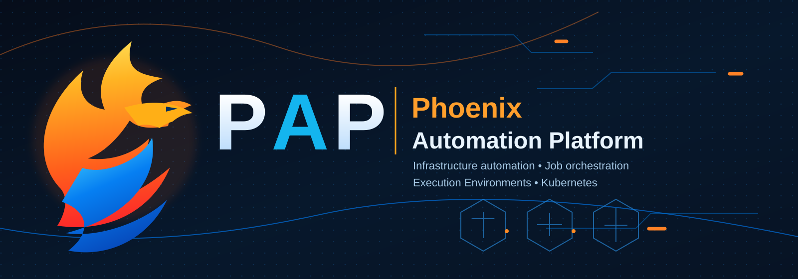
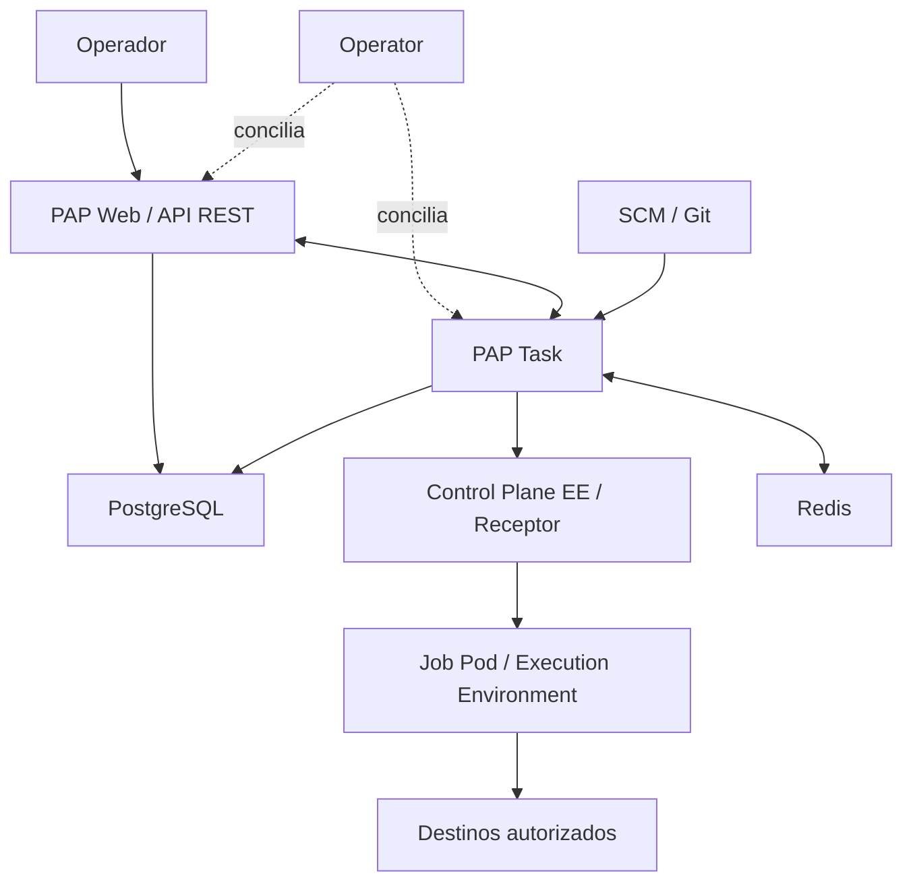

# 🔥 Phoenix Automation Platform (PAP)
### Community Edition — Espacio para contribuciones

**[Español](README.md) · [English](README.en.md)**

**Ansible · Kubernetes / K3s · AlmaLinux · Execution Environments**

[Proyecto](#-sobre-el-proyecto) · [Arquitectura](#-arquitectura) · [Participar](#-cómo-contribuir) · [Documentos](#-documentación-de-la-comunidad)

---

> **Proyecto comunitario en preparación.** Este repositorio reúne las reglas, documentación y propuestas de la comunidad de PAP. El código de distribución se incorporará en una fase posterior, una vez completada su revisión de licencia, dependencias y publicación. No contiene todavía una versión instalable.

## ✨ Sobre el proyecto

**Phoenix Automation Platform (PAP)** es una iniciativa independiente basada en componentes de **AWX** y otras tecnologías abiertas. Su propósito es conservar las capacidades de automatización Ansible —interfaz web, API REST, inventarios, proyectos, plantillas y Jobs— y evolucionar el empaquetado de contenedores, la trazabilidad de cambios y la experiencia operativa sobre Kubernetes/K3s.

El proyecto surgió de la necesidad de revisar dependencias e imágenes heredadas del release AWX 24.6.1, mediante una reconstrucción controlada con imágenes AlmaLinux y pruebas de integración.

### Áreas de colaboración

| Área | Ejemplos de aportes |
| --- | --- |
| **Contenedores** | Mejoras de construcción, compatibilidad de imágenes y dependencias |
| **Ansible** | Execution Environments, Runner, colecciones y pruebas de Jobs |
| **Kubernetes** | Manifiestos, operador, recursos y observabilidad de la aplicación |
| **Interfaz** | Accesibilidad, traducciones, documentación y experiencia |
| **Calidad** | CI, pruebas reproducibles y análisis de dependencias |
| **Documentación** | Guías, casos de uso, ejemplos y referencias |

## 🏗 Arquitectura

## ✅ Estado del proyecto

La versión candidata RC2 superó pruebas funcionales de laboratorio, incluyendo migración, interfaz/API y Jobs ejecutados desde dos Execution Environments personalizados. Este repositorio comunitario está en fase de preparación de su proceso de contribución y no sustituye la distribución técnica validada.

## 🤝 Cómo contribuir

1. Consulta [CONTRIBUTING.md](CONTRIBUTING.md) y revisa las incidencias existentes.
2. Propón una mejora mediante **Issue**, o crea un **Fork** para preparar código.
3. Trabaja en una rama de tu propio Fork y abre un **Pull Request** hacia la rama de integración `dev` cuando esté habilitada.
4. Describe los cambios, las pruebas y los posibles impactos.
5. El mantenimiento revisará y aceptará cada aporte antes de incluirlo.

La rama estable `prd` se reservará para promociones revisadas. **Por ahora no están configuradas las ramas comunitarias ni se aceptan cambios de código en producción.**

## 📚 Documentación de la comunidad

| Documento | Función |
| --- | --- |
| [README.en.md](README.en.md) | Presentación en inglés |
| [CONTRIBUTING.md](CONTRIBUTING.md) | Proceso de contribución y calidad |
| [CODE_OF_CONDUCT.md](CODE_OF_CONDUCT.md) | Normas de participación |
| [SECURITY.md](SECURITY.md) | Reporte responsable de fallos de seguridad |
| [SUPPORT.md](SUPPORT.md) | Dónde pedir ayuda y alcance |
| [NOTICE.md](NOTICE.md) | Procedencia y atribuciones |
| [LICENSE](LICENSE) | Condiciones de licencia |
| [docs/COMMUNITY-SETUP.md](docs/COMMUNITY-SETUP.md) | Preparación y protecciones previstas de `dev` y `prd` |

## ⚖️ Origen y licencias

PAP reconoce a [AWX](https://github.com/ansible/awx) como proyecto de referencia, publicado con licencia **Apache 2.0**. PAP es independiente y no debe confundirse con una distribución avalada oficialmente por los titulares de marcas de terceros. Consulta [NOTICE.md](NOTICE.md) y [LICENSE](LICENSE) para más información.

Build reproducible · Execute with control · Improve with community

